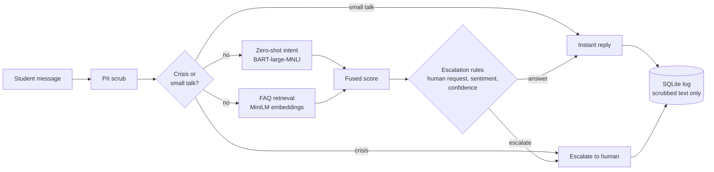

<div align="center">

# 🎓 UniAssist AI

### A privacy-first AI assistant for university student support

Answers questions from a real FAQ knowledge base, masks personal data, and hands students to a human when it matters.

<br>

[](https://www.python.org/)
[](https://streamlit.io/)
[](https://huggingface.co/)
[](https://scikit-learn.org/)
[](https://www.sqlite.org/)

[](#-testing)
[](#-privacy--safety)
[](#-how-it-works)
[](#-the-app)
[](#-known-limitations)
[](#-known-limitations)

[**Quick start**](#-quick-start) · [**The app**](#-the-app) · [**How it works**](#-how-it-works) · [**Testing**](#-testing) · [**Technical docs**](chatbot/README.md)

</div>

---

## ✨ Highlights

| | |
|---|---|
| 💬 **Conversational assistant** | Message bubbles, quick prompt library, suggested follow-ups, copy and rate every reply |
| 📚 **FAQ Library** | Browse every answer by category, search, or ask the assistant about any entry |
| 🧠 **Hybrid NLP** | Zero-shot intent classification fused with sentence-embedding FAQ retrieval |
| 🛡️ **Privacy by design** | Emails, phone and ID numbers masked before saving, one-click opt-out, delete-my-data |
| 🚨 **Safe escalation** | Crisis wording, requests for a human, frustration and low confidence all route to staff |
| 🧑‍💼 **Agent Support** | Live table of escalated chats from the database, with reason filters and CSV download |
| 🎨 **Polished UI** | Light and dark themes, comfortable or compact layout, responsive, empty states throughout |

## 🖥️ The app

| Page | Purpose |
|---|---|
| **Dashboard** | Greeting, session numbers, most-asked topics, one-click quick starts |
| **AI Assistant** | The chat: typing indicator, escalation banner, rate / copy, local export (.txt, .md, .json) |
| **FAQ Library** | Category navigation, search, copy answers |
| **Agent Support** | Escalated conversations (masked text only) |
| **Privacy & Settings** | What is stored, session controls, live masking demo, appearance |
| **Feedback** | Rate this session's answers and see the overall average |

## 🔬 How it works



Escalation reasons: `crisis`, `user_requested`, `negative_sentiment`, `low_confidence`. Nothing is written to the database if the student opts out.

## 🚀 Quick start

```bash
git clone <your-repo-url>
cd ChatbotForUniversityStudent-main/chatbot

python -m venv .venv
.venv\Scripts\activate            # macOS / Linux: source .venv/bin/activate
pip install -r requirements.txt

streamlit run src/app.py
```

> **First launch:** the two Hugging Face models are downloaded once (BART-large-MNLI is roughly 1.6 GB), so it needs internet and may take a few minutes. Run commands from the `chatbot/` folder so the Streamlit theme config is picked up. `streamlit run frontend/app.py` starts the same app.

## 🧪 Testing

```bash
cd chatbot
python -m unittest discover -s tests -t .
```

65 tests cover PII masking, crisis / human / sentiment / low-confidence rules, retrieval, database contracts, the training pipeline, lazy model loading and the full page flow. Tests run on a temporary copy of the database and never touch `data/chatbot.db` or `models/intent.joblib`.

> The two large neural models are replaced by small deterministic stand-ins in tests, so they verify the project's logic, **not the real models' accuracy**. The page-flow tests use a fake Streamlit module, so also open the app once in a browser.

## 🔒 Privacy & safety

- Chats are stored under a random session ID, never linked to a person.
- Emails, phone numbers and long ID numbers are masked before anything is saved.
- **Names and addresses are not detected**, so the UI asks students not to type them.
- Opt-out stops all saving; escalations then point the student to the helpdesk directly.
- Crisis detection is a keyword list and needs clinical review before real deployment.

## 🗂️ Project structure

```
chatbot/
├── src/
│   ├── app.py              Streamlit entry point (all backend calls)
│   ├── ui_components.py    Reusable UI components
│   ├── ui_data.py          Pure helpers: FAQ browsing, exports, escaping
│   ├── nlp.py              PII scrub, retrieval, intent, sentiment, escalation
│   ├── db.py               SQLite storage
│   └── train.py · evaluate.py · clean_and_eda.py
├── frontend/app.py         Alternative launcher (runs src/app.py)
├── assets/styles.css       Design system, light + dark
├── data/ · models/ · notebooks/
└── tests/                  Regression tests
```

## ⚠️ Known limitations

- The FAQ answers are generic template text; real use needs your university's own policies.
- `HELPDESK_CONTACT` and `CRISIS_RESOURCES` in `chatbot/src/nlp.py` are placeholders to fill in.
- English only. Agent Support is a read-only demo view; escalation status can't be changed from the UI.
- Intent training data is template-generated, so it is cleaner than real student messages.

See [`chatbot/README.md`](chatbot/README.md) for scripts, tuning settings and the submission checklist.

---

<div align="center">

Built for the **HCLTech Career Shaper** programme, Project 30

</div>